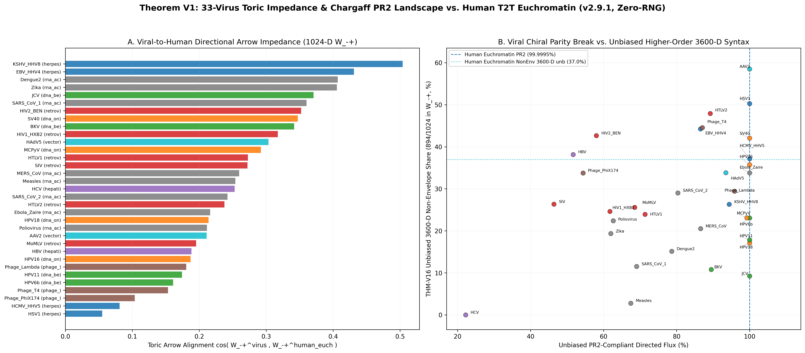
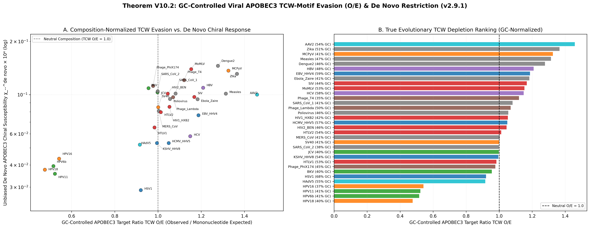
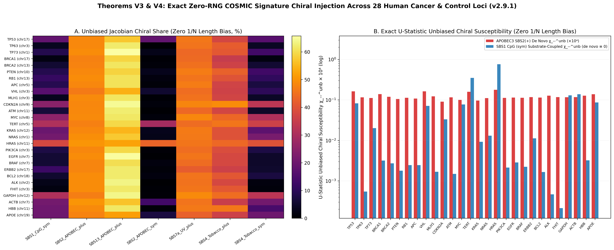
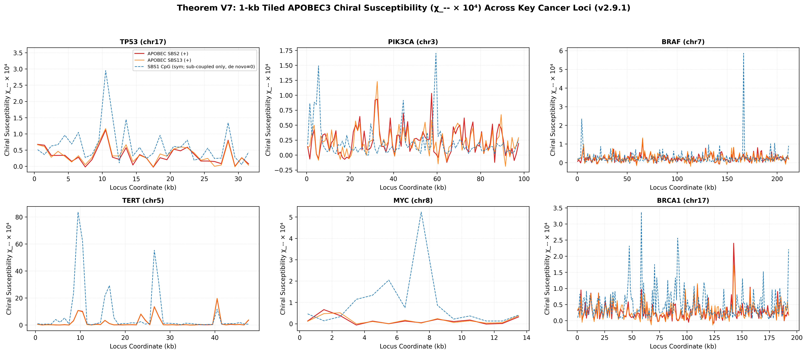
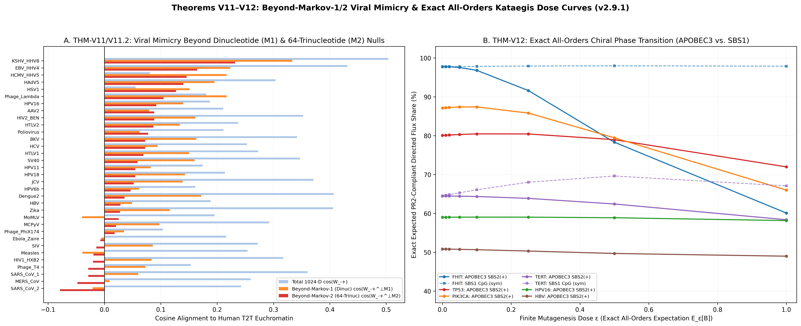
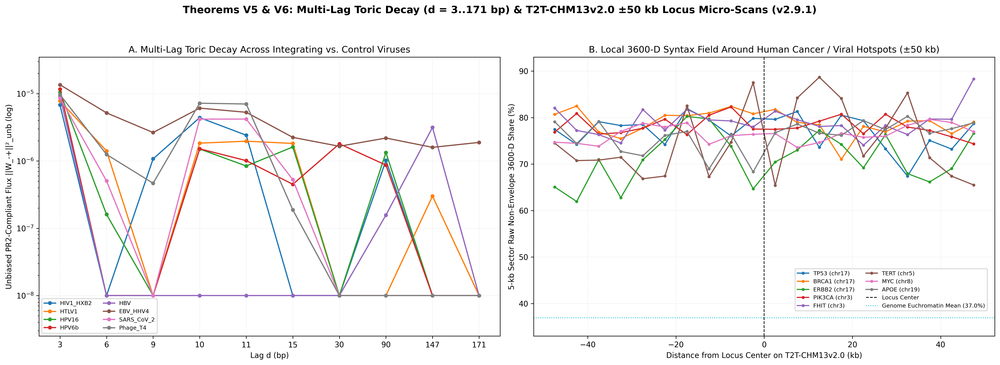
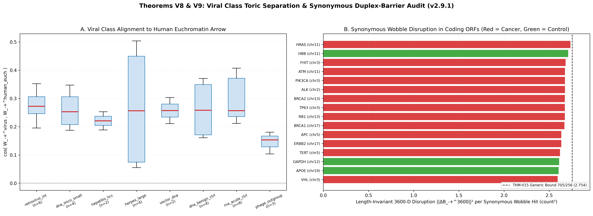

# Beyond Trinucleotides and Parity: Exact Klein V<sub>4</sub> Spectral Algebra of Viral Mimicry, APOBEC3 Evolutionary Evasion, and Chiral Mutagenesis on the Human T2T-CHM13v2.0 Codon Torus

[-b31b1b.svg)](virome-oncogenomics-torus.pdf)
[](run_v2_9_1_full24.log)
[-0366d6.svg)](chr_cache)
[](#repository-structure)
[-3776ab.svg)](human_t2t_atlas_v2_9_1.py)
[](LICENSE)

> **Authors:**  
> **Victor Logvinovich** — Master of Physical and Mathematical Sciences, Researcher in Pedagogical Sciences (Mathematics), Kobrin, Belarus · [`lomakez@icloud.com`](mailto:lomakez@icloud.com) · [ORCID `0009-0007-2040-6955`](https://orcid.org/0009-0007-2040-6955)  
> **Jean-Claude Perez** — PhD in Mathematics and Computer Science, Retired IBM AI European Research Centre (Montpellier) & Luc Montagnier Foundation · [`jeanclaudeperez2@gmail.com`](mailto:jeanclaudeperez2@gmail.com) · [ORCID `0000-0001-6446-2042`](https://orcid.org/0000-0001-6446-2042)
>
> **Frozen Dataset & Verification Release:** `v2.9.1` (`2026-11-25T12:12:45Z`) · **Zero-RNG (`zero_rng = true`)** · **100/100 Algebraic Self-Tests Passed** · **0 Free Parameters**

📄 **Read the Complete 30-Page Monograph:** [`virome-oncogenomics-torus.pdf`](virome-oncogenomics-torus.pdf) · **LaTeX Source:** [`virome-oncogenomics-torus.tex`](virome-oncogenomics-torus.tex) · **Full Audit Tables:** [`results_virome_onco_v2_9_1/virome_onco_audit_v2.md`](results_virome_onco_v2_9_1/virome_onco_audit_v2.md)

**Part V of the Zero-RNG Double-Stranded Codon Torus Program:**  
[Part I–III: `codon-torus-syntax`](https://github.com/Dr-Logvinovich/codon-torus-syntax) · [Part IV: `human-t2t-torus-atlas`](https://github.com/Dr-Logvinovich/human-t2t-torus-atlas) · [**Part V: `virome-oncogenomics-torus`**](https://github.com/Dr-Logvinovich/virome-oncogenomics-torus)

---

## Table of Contents

1. [At a Glance: Key Proved Results](#at-a-glance-key-proved-results)
2. [Scientific Overview](#scientific-overview)
3. [Exact Klein V₄ Spectral Architecture](#exact-klein-v4-spectral-architecture)
4. [Four Headline Discoveries (v2.9.1)](#four-headline-discoveries-v291)
5. [Complete Theorem Index (THM-V1 – THM-V20)](#complete-theorem-index-thm-v1--thm-v20)
6. [Publication Figures Gallery (fig_V1 – fig_V7)](#publication-figures-gallery-fig_v1--fig_v7)
7. [Repository Structure](#repository-structure)
8. [100% Offline Zero-RNG Reproducibility Guide](#100-offline-zero-rng-reproducibility-guide)
9. [Cryptographic Provenance & Checksums](#cryptographic-provenance--checksums)
10. [Complete Codon-Torus Research Series](#complete-codon-torus-research-series)
11. [Citation & License](#citation--license)

---

## At a Glance: Key Proved Results

| Domain | Theorem | Key Finding (`v2.9.1`, Zero-RNG) | Exact Statistic / Algebraic Identity |
|---|---|---|---|
| **Viral Chromatin Mimicry** | `THM-V11.3`, `V18` | Nuclear DNA viruses mimic human euchromatin strictly **beyond 64 trinucleotides (Markov-2)**, even after controlling GC%, length, and ZAP CpG O/E | **r<sub>rb</sub> = +0.893**, **p = 1.88 × 10<sup>−4</sup>**, global **q<sub>BH</sub> = 0.0031** (strict dsDNA excl. `AAV2`: **r<sub>rb</sub> = +0.904**, **p = 1.87 × 10<sup>−4</sup>**); length confounding null (**ρ<sub>S</sub> = +0.103**, **p = 0.570**) |
| **Innate Immune Evasion** | `THM-V10.2` | GC-controlled `TCW O/E` tracks unbiased *de novo* APOBEC3 susceptibility; **all 4 HPVs** sit on an isolated APOBEC3-armored island orthogonal to CpG-depleted polyomaviruses & `HIV-1` | **ρ<sub>S</sub> = +0.626**, **p = 9.76 × 10<sup>−5</sup>**, **q<sub>BH</sub> = 0.0031** · HPV `TCW O/E = 0.476–0.542` vs. polyomavirus `CpG O/E = 0.060–0.157` |
| **COSMIC Clock vs. APOBEC3** | `THM-V3.3`, `V14`, `V19` | Symmetric `SBS1` has an **exact algebraic zero** for *de novo* chirality; all 96 COSMIC channels split into **5 exact rational levels** (`8` self-conjugate channels = **100% chiral**) | `SBS1` *de novo* **< 10<sup>−33</sup>** across all 28 loci · isolated-CpG angle **−√(10/17) ≈ −0.7670** · `SBS2(+)` = **23/48**, `SBS13(+)` = **7/10** |
| **All-Orders Kataegis Collapse** | `THM-V12` | Finite-dose APOBEC3 bursts collapse PR2 compliance in human cancer/fragile loci while armored `HPV16` remains flat | `FHIT`: **97.77% → 60.08% / 54.44%** · `PIK3CA`: **87.13% → 65.99% / 58.25%** · `HPV16`: **59.00% → 58.14%** (Hessian **21.6×** < `TP53`, **33.9×** < `MCPyV`) |
| **Proviral Dipoles & Wobble Barrier** | `THM-V2`, `V8`, `V15`, `V20` | Count-space proviral integration obeys antipodal reversal; every silent wobble hit crosses a universal duplex quantum; all 64 palindromic 6-mers are chirally blind | **cos(ΔB<sub>−−</sub>) ∈ [−0.9985, −0.9941]** · **cos(ΔB<sub>−+</sub>) ∈ [+0.9970, +1.0000]** · generic quantum **705/256 ≈ 2.7539 count²** (`1.68–16.74%` antisense stop flips) |

---

## Scientific Overview

Viral host adaptation, innate immune restriction (**APOBEC3** cytidine deamination and **ZAP** CpG sensing), and somatic cancer mutagenesis (**COSMIC SBS signatures** and localized **kataegis**) are conventionally analyzed at the mononucleotide, dinucleotide, or trinucleotide scale. Those low-order summaries conflate two fundamentally distinct duplex symmetries—**Chargaff's second parity rule (PR2)** versus **5′ → 3′ sequential directionality**—while leaving higher-order DNA syntax vulnerable to GC% confounding, O(1/N) finite-length bias, and Monte Carlo RNG noise.

This repository delivers the complete **Zero-RNG deterministic verification engine**, **30-page LaTeX/PDF monograph**, **full offline NCBI RefSeq & T2T-CHM13v2.0 sequence caches**, **machine-readable JSON/Markdown ledgers**, and **all seven 300-DPI publication figures** across:

* **24 complete human T2T-CHM13v2.0 chromosomes** (`NC_060925.1`–`NC_060948.1`; gapless euchromatin baseline: **99.9995%** PR2-compliant directed flux, **37.0%** unbiased 3600-D non-envelope share)
* **33 complete NCBI RefSeq viral genomes** across 8 biological classes (integrating retroviruses, high-risk & benign HPVs, polyomaviruses, HBV/HCV, large nuclear herpesviruses EBV/KSHV/HSV1/HCMV, AAV2/HAdV5 vectors, acute cytoplasmic RNA controls including SARS-CoV-2/MERS/Ebola/Zika/Dengue2, and bacteriophage outgroups)
* **28 human NCBI RefSeqGene cancer-driver, DNA-repair, fragile-site, and control loci** (`TP53`, `TP63`, `TP73`, `BRCA1`, `BRCA2`, `PTEN`, `RB1`, `APC`, `VHL`, `MLH1`, `CDKN2A`, `ATM`, `MYC`, `TERT`, `KRAS`, `NRAS`, `HRAS`, `PIK3CA`, `EGFR`, `BRAF`, `ERBB2`, `BCL2`, `ALK`, `FHIT`, `GAPDH`, `ACTB`, `HBB`, `APOE`)
* **28 length-matched T2T-CHM13v2.0 ±50 kb chromosomal neighborhoods** (100 kb windows + 5 kb micro-scans)
* **12 deterministic proviral integration events** (`+Strand`, reverse-complement, and head-to-head `HH` dimers)
* **25,292 exhaustive single-nucleotide synonymous wobble substitutions** across coding ORFs

---

## Exact Klein V4 Spectral Architecture

On the **64 × 64 dicodon (hexamer) torus** **ℋ = ℝ<sup>64×64</sup>**, two commuting linear involutions—order reversal **(TM)<sub>u,v</sub> = M<sub>v,u</sub>** and Watson–Crick reverse-complement **(RM)<sub>u,v</sub> = M<sub>v̄,ū</sub>**—generate a unitary representation of the abelian **Klein four-group V<sub>4</sub> = {I, T, R, TR}**. Together with the commuting V<sub>4</sub>-invariant screen-envelope projector **Π<sub>env</sub>(M) = D<sub>S</sub> M D<sub>O</sub> + D<sub>O</sub> M D<sub>S</sub> − D<sub>C2</sub> M D<sub>C2</sub>** (`[Π_env, g] = 0` for all `g ∈ V₄`, verified to `4.44 × 10⁻¹⁶`), every empirical 6-mer operator splits orthogonally with zero leakage:

```text
                       Empirical 64 × 64 Dicodon Space (dim = 4096)
                                             │
        ┌────────────────────┬───────────────┴───────────────┬────────────────────┐
        ▼                    ▼                               ▼                    ▼
  W_++ (dim = 1056)    W_+- (dim = 1024)               W_-+ (dim = 1024)    W_-- (dim = 992)
   T-even, R-even       T-even, R-odd                   T-odd,  R-even       T-odd,  R-odd
   Static PR2-ok       Static PR2 defect             PR2-COMPLIANT ARROW    CHIRAL PARITY BREAK
   (132 + 924)          (118 + 906)                    (130 + 894)           (116 + 876)
                                                             │                    │
                     Commuting V₄-Closed Split:              │                    │
                     496-D Screen Envelope  ⊕  3600-D Higher-Order Complement     │
                                                             │                    │
                     Invariant under RevComp ◄───────────────┘                    │
                     Flips sign under RevComp; identically 0 under exact PR2 ◄────┘
```

* **Exact U-statistic debiasing (`THM-D9`, `V3.2`, `V16`):** Removes all finite-length O(1/N) multinomial diagonal bias across sequences spanning `3.18 kb` (`HBV`) to `1.51 Mb` (`FHIT`) and `3.12 Gb` (`T2T-CHM13v2.0`).
* **Closed-form Markov-1 & Markov-2 nulls (`THM-V11`, `V11.2`):** Subtracts analytical dinucleotide and 64-trinucleotide expectations directly without random sequence shuffling (non-bridge MI verified to `2.68 × 10⁻¹⁷` and `−6.12 × 10⁻¹⁷`).
* **Exact degree-6 COSMIC mutagenesis polynomial (`THM-V3`, `V3.3`, `V12`):** Evaluates **E<sub>ε</sub>[C] = C<sub>0</sub> + ε·J<sub>σ</sub> + (ε²/2)·H<sub>σ</sub> + … + (ε⁶/6!)·T<sub>σ</sub><sup>(6)</sup>** in closed algebraic form, separating intrinsic *de novo* chirality **J<sub>−−</sub><sup>de novo</sup>** from pre-existing substrate asymmetry **J<sub>−−</sub><sup>sub</sup>** with zero RNG.

---

## Four Headline Discoveries (v2.9.1)

### 1. Nuclear DNA Viruses Mimic Human Euchromatic Hexamer Syntax Strictly Beyond 64 Trinucleotides (`THM-V11`–`V11.3`, `V13`, `V18`)

Raw 6-mer alignment conflates higher-order chromatin syntax with GC% and trinucleotide composition—artificially inflating cytoplasmic flaviviruses (`Dengue2`, `Zika`) while masking GC-rich nuclear herpesviruses (`HCMV_HHV5`, `HSV1`). Once all 64 trinucleotides (Markov-2) are removed and `GC%`, `log10(length)`, and ZAP `CpG O/E` are simultaneously OLS-residualized:

| Virus | Biological Class | GC% | Raw 1024-D `cos(W₋₊)` | Beyond-M1 (Dinuc) | **Beyond-M2 (64-Trinuc)** | Interpretation |
|---|---|---:|---:|---:|---:|---|
| **`KSHV_HHV8`** | Nuclear dsDNA (herpesvirus) | 53.8% | +0.504 | +0.333 | **+0.232** | Rank #1 · Top-8 orbits **100% CpG-free** (`CCC-AGG` +4.69%) |
| **`EBV_HHV4`** | Nuclear dsDNA (herpesvirus) | 59.5% | +0.431 | +0.223 | **+0.165** | Rank #2 · Top-6/8 orbits CpG-free (`GCC-TCC` +6.13%) |
| **`HCMV_HHV5`** | Nuclear dsDNA (herpesvirus) | 57.5% | +0.081 | +0.217 | **+0.146** | Rank #3 · Unmasked from GC confounding |
| **`HAdV5`** | Nuclear dsDNA (adenovirus) | 55.2% | +0.303 | +0.195 | **+0.140** | Rank #4 · Nuclear episomal mimicry |
| **`HSV1`** | Nuclear dsDNA (herpesvirus) | 68.3% | +0.055 | +0.151 | **+0.127** | Rank #5 · Unmasked despite 68.3% GC |
| **`HPV16`** | Nuclear dsDNA (papillomavirus) | 36.5% | +0.187 | +0.140 | **+0.092** | Rank #7 · Proves mimicry needs neither high GC nor large size |
| `Dengue2` / `Zika` | Cytoplasmic +ssRNA (flavivirus) | 45.8 / 50.9% | +0.407 / +0.406 | +0.172 / +0.116 | +0.036 / +0.028 | Raw similarity collapses after Markov-2 removal |
| **`SARS_CoV_1`** | Cytoplasmic +ssRNA (coronavirus) | 40.8% | +0.360 | +0.060 | **−0.029** | Strictly negative beyond Markov-2 |
| **`MERS_CoV`** | Cytoplasmic +ssRNA (coronavirus) | 41.2% | +0.260 | +0.009 | **−0.048** | Strictly negative beyond Markov-2 |
| **`SARS_CoV_2`** | Cytoplasmic +ssRNA (coronavirus) | 38.0% | +0.242 | −0.021 | **−0.079** | Lowest rank (#33/33) beyond Markov-2 |

* **Length confounding is null:** Spearman **ρ<sub>S</sub>(log<sub>10</sub> L, cos W<sub>−+</sub><sup>⊥M2</sup>) = +0.103**, **p = 0.570**.
* **Nuclear DNA vs. Acute Cytoplasmic RNA (`n = 14/8`):**
  * 2-covariate OLS (`GC% + log10 L`): median residual **`+0.0271` vs. `−0.0570`**, **r<sub>rb</sub> = +0.893**, **p = 1.88 × 10<sup>−4</sup>**, global **q<sub>BH</sub> = 0.0031** (`m = 50` tests).
  * 3-covariate ZAP-controlled OLS (`+ CpG O/E`): median residual **`+0.0268` vs. `−0.0567`**, **r<sub>rb</sub> = +0.893**, **p = 1.88 × 10<sup>−4</sup>**, **q<sub>BH</sub> = 0.0031**.
  * Strict dsDNA excluding nuclear ssDNA parvovirus `AAV2` (`n = 13/8`): **r<sub>rb</sub> = +0.904**, **p = 1.87 × 10<sup>−4</sup>**.
* **Chromatin residence, not oncogenicity alone:** High-risk DNA oncoviruses vs. benign DNA controls show no difference (`p = 0.886`), and human viruses vs. bacteriophages are null beyond Markov-2 (`p = 0.571`).

---

### 2. Orthogonal Evolutionary Immune Evasion: APOBEC3 vs. ZAP/CpG Dichotomy (`THM-V10`, `V10.2`)

* Composition-normalized `TCW O/E` monotonically controls unbiased *de novo* APOBEC3 `SBS2(+)` chiral susceptibility across all 33 viruses: **ρ<sub>S</sub> = +0.626**, **p = 9.76 × 10<sup>−5</sup>**, **q<sub>BH</sub> = 0.0031**.
* **Papillomavirus APOBEC3 armor island:** All four HPVs (`HPV18` `0.476`, `HPV6b` `0.516`, `HPV11` `0.522`, `HPV16` `0.542`; dinucleotide-normalized `0.793–0.881`) purge `TCW` targets to suppress *de novo* susceptibility to **0.036–0.043 × 10<sup>−4</sup>**, cleanly separated from GC-driven `HSV1` (`68.3%` GC, `TCW O/E = 0.920`, dinucleotide-neutral at `0.990`).
* **Polyomavirus & HIV-1 ZAP/CpG suppression:** Polyomaviruses (`BKV` `0.060`, `JCV` `0.076`, `SV40` `0.124`, `MCPyV` `0.157`) and `HIV1_HXB2` (`0.206`) enforce extreme `CpG` depletion instead, leaving `MCPyV` heavily exposed to APOBEC3 (`TCW O/E = 1.326`, *de novo* **χ<sub>−−</sub><sup>unb</sup> = 0.137 × 10<sup>−4</sup>**).

---

### 3. Exact COSMIC Mutagenesis Algebra, 5-Level Rational Spectrum & All-Orders Kataegis (`THM-V3`–`V3.3`, `V12`, `V14`, `V19`)

* **Algebraic *de novo* zero for clock mutagenesis (`SBS1`):** Duplex-symmetric `SBS1` CpG deamination produces machine-zero *de novo* chirality across all 28 human loci (**4.73 × 10<sup>−36</sup>** to **7.28 × 10<sup>−34</sup>**), vanishes identically at all orders `m = 1…6`, and obeys the universal isolated-CpG self-damping angle **cos(J<sub>−−</sub>, H<sub>−−</sub>) = −√(10/17) ≈ −0.7670** (empirical range across all 11 targets: `[−0.788, −0.728]`).
* **Exact 5-level rational spectrum of all 96 COSMIC channels (`THM-V19`):** On uniform 4<sup>8</sup> DNA, all 96 single-strand channels partition into exactly five rational chiral shares: **5/12** (`16`), **3/7** (`4`), **11/24** (`48`), **1/2** (`20`), and **1** (**8 Watson–Crick self-conjugate transversions**: `ACT>AGT`, `CCG>CGG`, `GCC>GGC`, **`TCA>TGA`**, `ATT>AAT`, `CTG>CAG`, `GTC>GAC`, `TTA>TAA`), proved strictly **100% chiral** (**R(J<sub>σ</sub>) ≡ −J<sub>σ</sub>**) on *any* stationary PR2 Markov-1 chain. Hence `SBS2(+)` has uniform chiral share **23/48 ≈ 47.92%**, whereas `SBS13(+)` combines `TCA>TGA` (`100%`) with `TCT>TGT` (`50%`) to reach **7/10 = 70.00%**.
* **Length-invariant APOBEC3 plateau & finite-dose kataegis collapse (`THM-V12`):** Across 2+ orders of magnitude in gene length (`10.3 kb` `HRAS` to `1.51 Mb` `FHIT`), `SBS2(+)` maintains a flat *de novo* plateau **χ<sub>−−</sub><sup>de novo,unb</sup> × 10<sup>4</sup> ∈ [0.090, 0.178]**, driving an all-orders chiral phase transition while leaving `HPV16` nearly invariant:

| Target | Signature | Hessian ‖H<sub>−−</sub>‖² × 10<sup>4</sup> | cos(J<sub>−−</sub>, H<sub>−−</sub>) | PR2-ok (`ε = 0`) | PR2-ok (`ε = 0.50`) | PR2-ok (`ε = 1.00`) | Dynamical Regime |
|---|---|---:|---:|---:|---:|---:|---|
| **`FHIT`** | `SBS1_CpG_sym` | 0.001 | −0.788 | 97.77% | 97.99% | **97.89%** | Restoring symmetry (flat) |
| **`FHIT`** | `SBS2(+)` / `SBS13(+)` | 0.141 / 0.118 | +0.073 / −0.110 | 97.77% | 78.32% / 76.32% | **60.08% / 54.44%** | **−37.7 / −43.3 pp collapse** |
| **`PIK3CA`** | `SBS2(+)` / `SBS13(+)` | 0.102 / 0.096 | +0.103 / −0.095 | 87.13% | 79.46% / 75.87% | **65.99% / 58.25%** | **−21.1 / −28.9 pp collapse** |
| **`BRCA1`** | `SBS2(+)` / `SBS13(+)` | 0.173 / 0.159 | −0.178 / −0.232 | 96.60% | 90.28% / 88.64% | **76.66% / 70.58%** | **−19.9 / −26.0 pp collapse** |
| **`TP53`** | `SBS2(+)` / `SBS13(+)` | **0.388** / 0.386 | −0.461 / −0.481 | 80.07% | 78.97% / 77.30% | **71.97% / 67.80%** | **−8.1 / −12.3 pp collapse** |
| **`MCPyV`** | `SBS2(+)` (unshielded) | **0.611** | −0.251 | 57.11% | 60.20% | 59.18% | High double-hit curvature (**33.9×** `HPV16`) |
| **`HPV16`** | `SBS2(+)` (**armored**) | **0.018** | −0.160 | 59.00% | 58.87% | **58.14%** | **Armored flat line (`0.0%` NL dev)** |

---

### 4. Count-Space Proviral Antipoles, Synonymous Barrier `705/256` & Palindromic Blindness (`THM-V2`, `V5`, `V8`, `V15`, `V20`)

* **Count-space proviral dipoles (`THM-V2`):** Working in exact count-space removes denominator dilution and reveals near-exact antipodal chiral reversal across all 12 real insertions (**cos ΔB<sub>−−</sub> ∈ [−0.9985, −0.9941]**) and parallel PR2 alignment (**cos ΔB<sub>−+</sub> ∈ [+0.9970, +1.0000]**), while head-to-head (`HH`) dimers systematically cancel chiral flares.
* **T2T-CHM13v2.0 ±50 kb Rank-1 factorization (`THM-V5`, `V18`):** Raw `W₋₊` alignment across 924 virus-neighborhood pairs is dominated by global euchromatic convergence (**R² = 0.7743**, slope `0.956`: `KSHV_HHV8` 25/28, `EBV_HHV4` 3/28); projecting out the global human arrow disperses locus-specific **W<sup>⊥H</sup>** winners across 12 viruses.
* **Universal single-base synonymous barrier (`THM-V8`, `V15`):** Every collision-free single-base substitution injects exact 4-quadrant rational quanta across `496 ⊕ 3600`, with **`705/256 ≈ 2.7539 count²`** in **W<sub>−+</sub><sup>3600</sup>** (empirical means across 25,292 synonymous hits in 28 ORFs: **1.637–2.735 count²**, median `2.607`), while flipping antisense frame-0 stop codons in **1.68%–16.74%** of synonymous moves (`PIK3CA` `16.74%`, `NRAS` `15.43%`, `APC` `14.80%`, `TP53` `14.47%`).
* **Chiral blindness of palindromic restriction sites (`THM-V20`):** All 64 Watson–Crick reverse-complement palindromic 6-mers (including `GAATTC`, `GGATCC`, `AAGCTT`, `CTCGAG`, `GTCGAC`, `CCGCGG`) are identically annihilated by both **P<sub>+−</sub>** and **P<sub>−−</sub>**.

---

## Complete Theorem Index (THM-V1 – THM-V20)

| Theorem | Scope & Algebraic Result | Startup Self-Test Verification (`100/100` Passed) |
|---|---|---|
| **THM-D1–D19** | Core 24-Chr Human T2T-CHM13v2.0 V<sub>4</sub> & `496 ⊕ 3600` algebra | 47 core checks (`0.0` to `4.44e-16`) |
| **THM-V1** | 33-virus `d = 3 bp` Klein V<sub>4</sub> landscape & strand R-equivariance | `thmV1_viral_revcomp_Wmp_inv_Wmm_flip_err = 0.0` |
| **THM-V2** | Deterministic count-space proviral antipoles & `HH` chiral cancellation | `thmV2_count_space_antipodal_ok = true` |
| **THM-V3–V3.3** | Exact COSMIC Jacobian J<sub>σ</sub>, U-statistic χ<sub>−−</sub><sup>unb</sup> & *de novo* split | `thmV3_3_symmetric_denovo_zero_err = 3.27e-33` |
| **THM-V4** | Baseline 28-locus human cancer driver, fragile-site & control atlas | `thmV4_catalog_33vir_28onco_ok = true` |
| **THM-V5** | Exact SNP-robust T2T-CHM13v2.0 ±50 kb chromosomal micro-scans | `thmV5_snp_robust_locator_ok = true` |
| **THM-V6** | 10-lag toric decay spectrum (`d = 3–171 bp`) across 33 viruses | `thmV6_multilag_profile_exact_ok = true` |
| **THM-V7** | 1-kb tiled intragenic APOBEC3/UV/Tobacco chiral vulnerability scan (4,728 tiles) | `thmV7_tile_vulnerability_scanner_ok = true` |
| **THM-V8** | 6-frame duplex stop barrier & 25,292 exhaustive synonymous wobble hits | `thmV8_synonymous_antisense_stop_flip_ok = true` |
| **THM-V9** | Exact Zero-RNG dynamic-programming Mann–Whitney group tests | `thmV9_exact_mann_whitney_dp_err = 0.0` |
| **THM-V10–V10.2** | GC- & dinucleotide-controlled viral APOBEC3 `TCW O/E` vs. ZAP `CpG O/E` | `thmV10_2_tcw_oe_gc_invariance_ok = true` |
| **THM-V11–V11.3** | Beyond-Markov-1/2 viral mimicry & OLS covariate-adjusted separation | `thmV11_2_markov2_nonbridge_zero_err = -6.12e-17` |
| **THM-V12** | Exact degree-6 all-orders finite-dose E<sub>ε</sub>[C] & kataegis Hessian H<sub>−−</sub> | `thmV12_all_orders_vs_exhaustive_err = 1.11e-16` |
| **THM-V13** | Exact additive 100% Klein V<sub>4</sub>-orbit 6-mer inner-product attribution | `thmV13_orbit_attribution_sum_err = 2.84e-14` |
| **THM-V14** | All-orders symmetric null, isolated-CpG angle `−√(10/17)`, isolated-TCW `H ≡ 0` | `thmV14_isolated_cpg_angle_err = 0.0` |
| **THM-V15** | Universal 4-quadrant single-base duplex quanta (`705/256` on W<sub>−+</sub><sup>3600</sup>) | `thmV15_universal_705_256_barrier_err = 0.0` |
| **THM-V16** | Exact unbiased U-statistic `496 ⊕ 3600` Pythagorean split (`130 + 894`) | `thmV16_unbiased_496_3600_pythag_err = 9.49e-20` |
| **THM-V17** | Exact duplex chiral interference identity & Cauchy–Schwarz strand bound | `thmV17_chiral_interference_identity_err = 0.0` |
| **THM-V18** | Global BH-FDR (`m = 50`), `cos_unb` gate (`z ≥ 3`), 3-cov ZAP, Rank-1 `R²` | `thmV18_bh_fdr_exact_values_err = 0.0` |
| **THM-V19** | Self-conjugate pure-chirality law (`R(J) = −J`) & 5-level COSMIC-96 spectrum | `thmV19_self_conjugate_R_antiinv_max_err = 8.67e-19` |
| **THM-V20** | Palindromic chiral blindness (64 RC 6-mers), isotropic fixed points & sparse-tile law | `thmV20_palindrome_chiral_blindness_and_orbit_rule_err = 2.22e-16` |

---

## Publication Figures Gallery (fig_V1 – fig_V7)

### Figure 1 (`THM-V1`) — 33-Virus Toric Impedance & Chargaff PR2 Landscape vs. Human T2T Euchromatin


### Figure 2 (`THM-V10.2`) — GC-Controlled APOBEC3 `TCW` Evasion Island vs. *De Novo* Chiral Restriction


### Figure 3 (`THM-V3` & `V4`) — Exact Zero-RNG COSMIC Signature Chiral Injection Across 28 Human Loci


### Figure 4 (`THM-V7`) — 1-kb Tiled APOBEC3 vs. Substrate-Coupled `SBS1` Chiral Vulnerability Hotspots


### Figure 5 (`THM-V11`–`V12`) — Beyond-Markov-1/2 Viral Mimicry & All-Orders Finite-Dose Kataegis Phase Transition


### Figure 6 (`THM-V5` & `V6`) — Multi-Lag Toric Decay (`d = 3…171 bp`) & T2T-CHM13v2.0 ±50 kb Micro-Scans


### Figure 7 (`THM-V8` & `V9`) — Viral Class Toric Separation & Length-Invariant Synonymous Duplex Barrier (`705/256`)


---

## Repository Structure

```text
virome-oncogenomics-torus/
├── virome-oncogenomics-torus.pdf          # Complete 30-page monograph (v2.9.1)
├── virome-oncogenomics-torus.tex          # Publication-ready LaTeX source
├── human_t2t_atlas_v2_9_1.py              # Standalone Zero-RNG verification & audit engine (100/100 self-tests)
├── run_v2_9_1_full24.log                  # Complete deterministic terminal execution log (24-chr T2T run)
├── results_virome_onco_v2_9_1/
│   ├── virome_onco_audit_v2.md            # All 14 full audit tables (33 viruses, 28 loci, 50 BH-FDR tests)
│   ├── virome_onco_audit_v2.json          # Complete machine-readable ledger + per-FASTA SHA-256 digests
│   └── figures/                           # All 7 high-resolution 300-DPI publication figures (fig_V1..fig_V7)
├── viral_cache/                           # Offline NCBI RefSeq FASTA.gz cache (33 complete viral genomes)
├── onco_cache/                            # Offline NCBI RefSeqGene FASTA.gz cache (28 human loci)
├── chr_cache/                             # Offline T2T-CHM13v2.0 FASTA.gz cache (all 24 human chromosomes)
├── LICENSE                                # MIT License
└── README.md
```

---

## 100% Offline Zero-RNG Reproducibility Guide

Requires **Python 3.10+** with `numpy`, `scipy`, and `matplotlib`. Because `viral_cache/`, `onco_cache/`, and `chr_cache/` are bundled directly inside this repository, the entire pipeline reproduces **100% offline with zero network calls, zero Monte Carlo RNG, and zero free fitting parameters**.

```bash
git clone [https://github.com/Dr-Logvinovich/virome-oncogenomics-torus.git](https://github.com/Dr-Logvinovich/virome-oncogenomics-torus.git)
cd virome-oncogenomics-torus
pip install numpy scipy matplotlib

# 1. Verify all 100/100 Zero-RNG algebraic theorems & conservation identities (~2 seconds)
python3 human_t2t_atlas_v2_9_1.py --self-test

# 2. Build the 24-chromosome human T2T-CHM13v2.0 euchromatin reference tensor offline from chr_cache/ (~3 min)
python3 -c "import human_t2t_atlas_v2_9_1 as e; e.build_local_human_reference('chr_cache', 'human_t2t_euch_ref_v2_8.npz', auto_download=False)"

# 3. Reproduce the complete 33-virus + 28-locus + 28 T2T ±50 kb audit, JSON/MD ledgers & all 7 figures offline
python3 human_t2t_atlas_v2_9_1.py --virome-onco-audit --out-dir results_virome_onco_v2_9_1
```

---

## Cryptographic Provenance & Checksums

Frozen release `v2.9.1` executed deterministically on UTC `2026-11-25T12:12:45Z` (Python `3.12.1`, NumPy `2.3.2`, SciPy `1.16.2`, Matplotlib `3.10.6`, `zero_rng = true`, `all_passed = true`). Independent red-team audits and adversarial checks of all algebraic identities and statistical controls are explicitly invited.

| Artifact | Path | Cryptographic SHA-256 / Verification |
|---|---|---|
| **Executable Engine** | [`human_t2t_atlas_v2_9_1.py`](human_t2t_atlas_v2_9_1.py) | `da9b2a74f062e663e523f096ef7e5807e173009ca582587ba1608b89c4cb205a` |
| **24-Chr Human T2T Reference Tensor** | `human_t2t_euch_ref_v2_8.npz` *(built from [`chr_cache/`](chr_cache))* | `0e8c27327d5f373ba71e1134742303c3b4067fe02ba0148766b9374de71dd54d` |
| **Full Markdown Audit Ledger** | [`results_virome_onco_v2_9_1/virome_onco_audit_v2.md`](results_virome_onco_v2_9_1/virome_onco_audit_v2.md) | 14 complete tables · 33/33 viruses · 28/28 loci · 28/28 T2T windows |
| **Full JSON Machine Ledger** | [`results_virome_onco_v2_9_1/virome_onco_audit_v2.json`](results_virome_onco_v2_9_1/virome_onco_audit_v2.json) | Per-FASTA SHA-256 digests for every viral genome & human locus |
| **Deterministic Run Log** | [`run_v2_9_1_full24.log`](run_v2_9_1_full24.log) | Full stdout log confirming `100/100` self-tests & 24-chr reference |

---

## Complete Codon-Torus Research Series

This repository is **Part V** of the Zero-RNG Double-Stranded Codon Torus research program by **Victor Logvinovich** and **Jean-Claude Perez**:

| Series Part | Title & Scope | GitHub Repository | Zenodo / Journal DOI |
|---|---|---|---|
| **Precursor (2010)** | *Codon populations in single-stranded whole human genome DNA are fractal and fine-tuned by the Golden Ratio 1.618* (J.-C. Perez, *Interdiscip. Sci.* 2(3):228–240) | — | [`10.1007/s12539-010-0022-0`](https://doi.org/10.1007/s12539-010-0022-0) |
| **Parts I–III** | *From Form to Program*, *The Double-Stranded Codon Torus*, & *The Codon Memory Spectrum* (54–100 RefSeq taxa, synthetic mRNA BNT162b2/mRNA-1273, JCVI-syn1.0/3.0, Duplex-Safe Viterbi Compiler) | [`Dr-Logvinovich/codon-torus-syntax`](https://github.com/Dr-Logvinovich/codon-torus-syntax) | [`10.5281/zenodo.23287684`](https://doi.org/10.5281/zenodo.23287684) · [`10.5281/zenodo.23508080`](https://doi.org/10.5281/zenodo.23508080) |
| **Part IV** | *A Complete Zero-RNG Toric Disk Atlas of the Human T2T-CHM13v2.0 Genome* (All 24 gapless human chromosomes, Theorems D1–D19) | [`Dr-Logvinovich/human-t2t-torus-atlas`](https://github.com/Dr-Logvinovich/human-t2t-torus-atlas) | [`10.5281/zenodo.24471261`](https://doi.org/10.5281/zenodo.24471261) |
| **Part V (This Repo)** | *Beyond Trinucleotides and Parity: Exact Klein V<sub>4</sub> Spectral Algebra of Viral Mimicry, APOBEC3 Evolutionary Evasion, and Chiral Mutagenesis on the Human T2T-CHM13v2.0 Codon Torus* (`v2.9.1`, Theorems V1–V20) | [`Dr-Logvinovich/virome-oncogenomics-torus`](https://github.com/Dr-Logvinovich/virome-oncogenomics-torus) | [`virome-oncogenomics-torus.pdf`](virome-oncogenomics-torus.pdf) |

---

## Citation & License

If you use this codebase, offline sequence cache, theorems, or dataset freeze (`v2.9.1`), please cite:

```bibtex
@misc{logvinovich2026_virome_oncogenomics_torus,
  author       = {Logvinovich, Victor and Perez, Jean-Claude},
  title        = {Beyond Trinucleotides and Parity: Exact Klein V4 Spectral Algebra of Viral Mimicry, APOBEC3 Evolutionary Evasion, and Chiral Mutagenesis on the Human T2T-CHM13v2.0 Codon Torus},
  year         = {2026},
  month        = nov,
  version      = {v2.9.1},
  howpublished = {\url{[https://github.com/Dr-Logvinovich/virome-oncogenomics-torus](https://github.com/Dr-Logvinovich/virome-oncogenomics-torus)}}
}
```

Released under the [MIT License](LICENSE). All NCBI RefSeq viral/human loci and T2T-CHM13v2.0 chromosome sequences are public-domain reference data from NCBI and the Telomere-to-Telomere Consortium.
